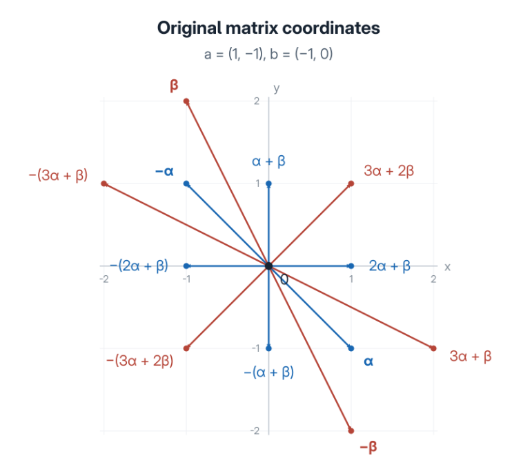

# This contains the analysis of the Combinatorial type of each polytope appearing as Chevaley polytopes 

A cone of the tropical variety is _prime_ when the initial ideal with respect to a weight in the relative interior of this cone is a prime ideal. 
When a prime cone is of maximal dimension (that is dimension of the algebraic variety), a theorem of Kaveh and Manon implies that it is binomial, and hence yields a toric degenrations of our algebraic variety.

Our tropical $G_2$-Grassmannian has a lineality space of dimension $2$ in $\mathbb R^{21}/\mathbb{R}\mathbf 1$ generated by the image by the linear map $f\colon(x_i)_{i\in[7]}\mapsto (x_i+x_j)_{i<j}$ of the rows of
$$
    \begin{bmatrix}
    1&-1 & 0 & -1 & 1 & 0& 0\\
    -1&0 & 1 & 1 & 0 & -1 &0
    \end{bmatrix} = \left[a, b, -(a+b), -a, -b,a+b, \mathbf 0 \right],
$$
We have:
$$
    L=f\left(\left[a, b, -(a+b), -a, -b,a+b, \mathbf 0 \right]\right) = \left[a+b,-b,\mathbf0,a-b,2a+b,a,-a,b-a,\mathbf0,a+2b,b, -(2a+b),-(a+2b),\mathbf0,-(a+b), -(a+b),b,-a, a, -b,a+b \right]
$$
If we write $\alpha= a$ and $\beta = -2a-b$ then the columns of this matrix are in the set
$\left\{0,\ \pm\alpha,\ \pm\beta,\ \pm(\alpha+\beta),
\pm(2\alpha+\beta),\ \pm(3\alpha+\beta),
\pm(3\alpha+2\beta)
\right\},$
where $\alpha$ and $\beta$ are respectively the short and long simple roots of $G_2$.

In particular The convex hull of these points is a hexagon $H\in\mathbb R^2$, and its $G_2$-lattice points are exactly these roots.

We checked every cone in each of the 31 Weyl orbits of the tropicla $G_2$-Grassmannian over $\mathbb Q$: 17 are prime, and they all are simplicial.

For a prime cone $C$, let $r_1,\ldots,r_3$ be its three Weyl-normalized primitive rays generators, that is they are orthogonal to the lineality space.
Let $R$ be the matrix whosoe rows are the $r_i$'s.

Each Newton-Okounkov polytope $P(C)$ is a $5$-dimensional polytope which is the convex hull of the 21 column vectors of the matrix $\begin{bmatrix}M\\L\end{bmatrix}$.

We try to identify the combinatorial type or the complete description of this polytope:
Orbit| Type
|--|--|
1| Pyramid(Unrecognized(4D; 8 vertices, 8 facets))
2| Pyramid(Pyramid(multiplex M(3, 5)))
3| Pyramid(Unrecognized(4D; 9 vertices, 8 facets))
4| Pyramid(multiplex M(4, 7))
5| Pyramid(Unrecognized(4D; 8 vertices, 8 facets))
6| Pyramid(Pyramid(Wedge(4-gon; face=point)))
7| Pyramid(Wedge(Pyramid(4-gon); face=segment))
8| Pyramid(Unrecognized(4D; 9 vertices, 8 facets))
9| Pyramid(Pyramid(Pyramid(4-gon)))
10| Pyramid(Pyramid(multiplex M(3, 5)))
11| Pyramid(Unrecognized(4D; 9 vertices, 9 facets))
12| Pyramid(Pyramid(multiplex M(3, 5)))
13| Pyramid(Unrecognized(4D; 9 vertices, 8 facets))
14| Pyramid(Wedge(multiplex M(3, 5); face=segment))
15| Pyramid(Wedge(Pyramid(4-gon); face=segment))
16| Wedge(Pyramid(Δ1 × Δ2); face=3-gon)
17| Pyramid(Pyramid(Δ1 × Δ2))
18| Pyramid(Wedge(multiplex M(3, 5); face=3-gon))
19| Wedge(Pyramid(multiplex M(3, 5)); face=3-gon)
20| Pyramid(Pyramid(Pyramid(4-gon)))
21| Pyramid(Wedge(multiplex M(3, 5); face=segment))
22| Wedge(Wedge(Pyramid(4-gon); face=segment); face=3-gon)
23| Pyramid(Wedge(Pyramid(4-gon); face=segment))
24| Pyramid(Pyramid(augmented triangular prism (J49)))
25| Pyramid(Pyramid(4-gonal antiprism))
26| Pyramid(Pyramid(4-gonal antiprism))
27| 5-simplex
28| Pyramid(Pyramid(Δ1 × Δ2))
29| 5-simplex
30| Pyramid(Pyramid(Pyramid(4-gon)))
31| 5-simplex

In particular, for every prime cone $C$, the projection $\pi_{45}$ onto the last two coordinates maps $P(C)$ to the hexagon $H$ by $\pi_{45}\colon P\to H$. The fiber of this projection is a $3$-polytope $F(C)$ that we describe in the following table for every Weyl-orbit.

|Orbit number | F(C)|
|----|---|
1| Unrecognized(3D; 14 vertices, 10 facets)
2| Unrecognized(3D; 7 vertices, 6 facets)
3| Unrecognized(3D; 8 vertices, 7 facets)
4| Unrecognized(3D; 15 vertices, 11 facets)
5| Unrecognized(3D; 9 vertices, 7 facets)
6| 5-gonal prism
7| 3-cube
8| Unrecognized(3D; 11 vertices, 8 facets)
9| 3-cube
10| Unrecognized(3D; 10 vertices, 8 facets)
11| Unrecognized(3D; 9 vertices, 8 facets)
12| multiplex M(3, 5)
13| Unrecognized(3D; 8 vertices, 7 facets)
14| 5-gonal prism
15| 3-cube
16| 3-cube
17| Δ1 × Δ2
18| 3-cube
19| 3-cube
20| Δ1 × Δ2
21| Unrecognized(3D; 10 vertices, 7 facets)
22| 3-cube
23| 3-cube
24| Unrecognized(3D; 7 vertices, 8 facets)
25| Unrecognized(3D; 14 vertices, 11 facets)
26| Unrecognized(3D; 8 vertices, 10 facets)
27| 3-simplex
28| Δ1 × Δ2
29| 3-cube
30| Δ1 × Δ2
31| 3-simplex